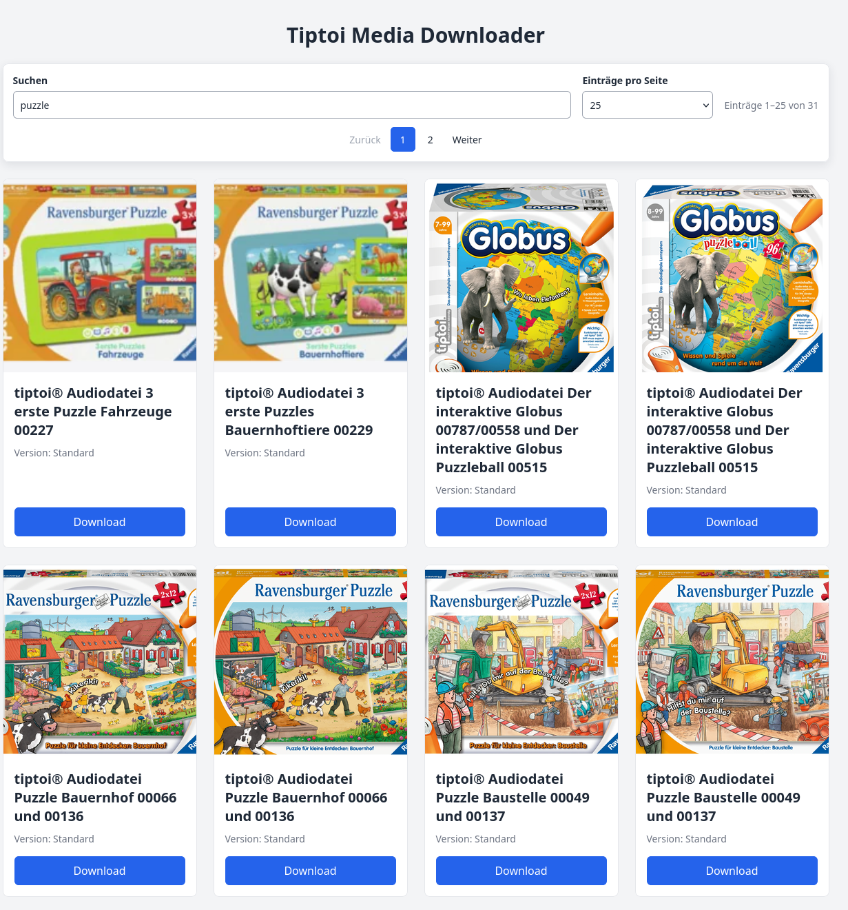

# Tiptoi Audio Link Catalog

[Deutsch](README.md)

A private, unofficial web interface for browsing publicly accessible tiptoi® audio entries. The scraper stores titles, preview images, and URLs to `.gme` files in SQLite. The download link then opens the file from its respective provider.

## Important Notes

- This project is **not affiliated with Ravensburger or tiptoi®**, is not supported by them, and is not an official product.
- The project was created exclusively for private, experimental purposes. This does not grant permission to use or redistribute downloaded content.
- To the best of the project's knowledge, Ravensburger currently does not offer official native tiptoi® software for Linux. This independent web interface is not an official replacement.
- The project was created entirely with AI. The code, documentation, and design were AI-generated; no guarantee is made that they have been fully reviewed for technical or legal correctness.
- Trademarks, product names, images, and audio files belong to their respective rights holders. This project does not include or license those materials. Check the applicable terms and rights before using them. Do not publish or distribute content unless you are authorized to do so.

## Features

- Scrapes product titles, preview images, and `.gme` links from the Ravensburger support site.
- Filters titles as you type, including German umlauts.
- Offers page sizes of 25, 50, 75, 100, or all entries.
- Keeps the search and page navigation sticky while scrolling.
- Starts in dark mode. A sun-and-crescent icon button switches themes, and the selection is stored in the browser.
- Keeps the theme button beside the first title line on mobile screens.
- Redirects the download link to the external `.gme` file. The scraper does not download the audio file or store it in SQLite or under `/data`.
- Saves scraper results to SQLite after each product page and prevents duplicate audio URLs.
- Uses `./media_data` as a persistent host bind mount for the database.

## Screenshots

The screenshots below use synthetic sample records and neutral placeholder artwork. They do not contain Ravensburger images or audio files.

### Desktop


### Search



### Mobile


## Run with Docker Compose

Requirements: Docker Engine and Docker Compose V2. The default Compose file uses the published GHCR image; local source changes are included only after a new image is published. Both services mount `./media_data` at `/data` and default to UID/GID `1000:1000`.

If needed, create a `.env` file in the project directory with the host user's IDs:

```dotenv
PUID=1000
PGID=1000
SCRAPER_CRON="0 3 * * *"
```

Adjust the values if `id -u` or `id -g` reports different IDs. The `media_data` directory and any existing `database.db` must be writable by those IDs. On Linux, correct ownership when necessary with:

```sh
sudo chown -R "$(id -u):$(id -g)" media_data
```

### Published Image

```sh
docker compose up -d
```

Then open <http://localhost:8000>. Compose starts the web interface and runs the scraper once immediately, then follows the schedule. `SCRAPER_CRON` uses a five-field cron expression in UTC and defaults to daily at 03:00 UTC. Set a different value in `.env` to change the schedule. Follow the scraper output with:

```sh
docker compose logs -f scraper
```

To run the scraper manually once without scheduling:

```sh
docker compose run --rm -e SCRAPER_CRON= scraper
```

The SQLite file is located at `media_data/database.db` on the host and `/data/database.db` inside the container. `docker compose down` removes the containers but keeps the bind-mounted directory and database. To delete the database, remove the file from the host directory intentionally.

### Local Development

`compose-dev.yaml` builds the workspace source with `Dockerfile-dev` and runs the containers as user `app` with the configured PUID/PGID values:

```sh
docker compose -f compose-dev.yaml up -d --build
```

The dev Compose file starts the scraper as a dependency of the web service, so restarting the web service may also start a scrape. To rebuild and start only the web service:

```sh
docker compose -f compose-dev.yaml build web
docker compose -f compose-dev.yaml up -d --no-deps web
```

The scraper logs product pages found, audio links found, and newly saved rows separately. `Found ... product pages` does not mean those products have already been stored in SQLite. Results are committed after each product page, so saved rows survive an interrupted run. Duplicate audio URLs are ignored.

## Architecture

- **Web:** FastAPI, Jinja2, and local CSS files.
- **Scraper:** Python standard library (`urllib` and `html.parser`) plus APScheduler for the cron schedule; Chromium is not required.
- **Database:** SQLite with unique audio URLs.
- **Container:** `compose.yaml` uses the published image; `compose-dev.yaml` builds the local source. Both use a host bind mount for the SQLite file.

## License and Rights

No **open-source license file** is currently included for this private, entirely AI-generated project. Without a license, no explicit permission is granted to reuse the project code; the legal status of AI-generated content depends on the specific circumstances and jurisdiction.

If you later decide to make the original project code available for reuse, MIT is a simple option **only for original code that you are legally entitled to license**. Such a license would not grant rights to Ravensburger/tiptoi®, images, audio files, or other third-party content. This is not legal advice.
