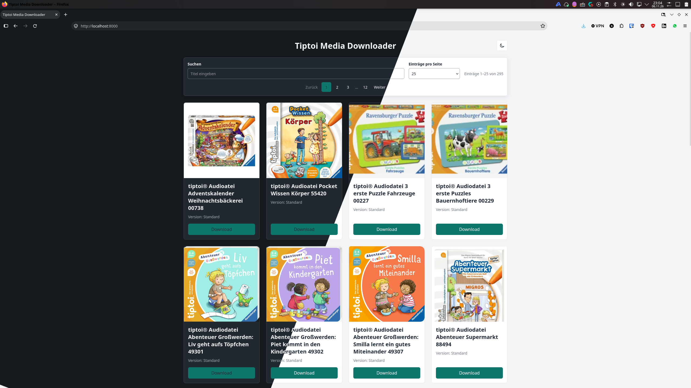
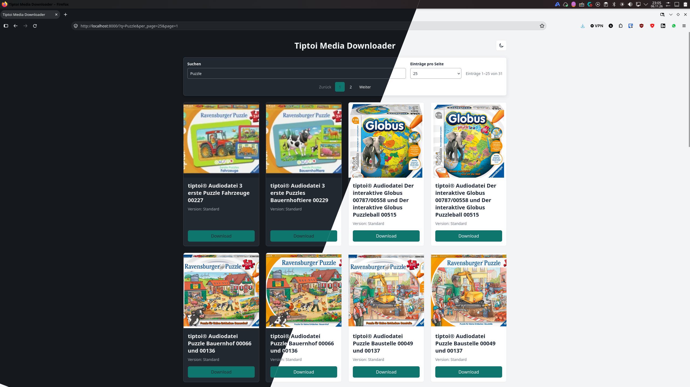
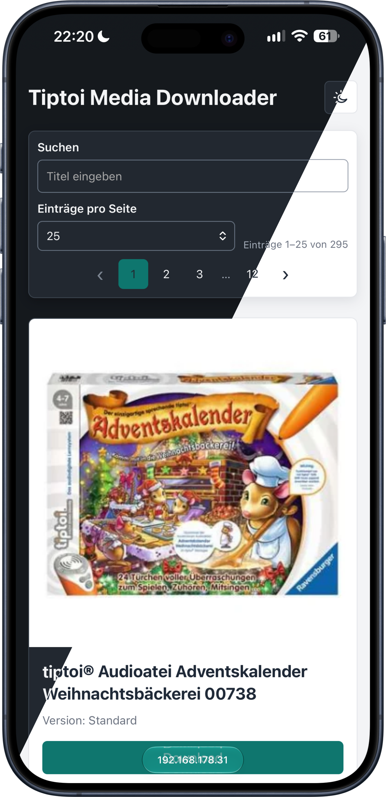

# Tiptoi Media Downloader

🇩🇪 [German](README.md)

A private, non-official web interface for browsing publicly accessible tiptoi® audio entries. This catalog serves as a user-friendly interface to find content and open it via the respective providers.

## Important Notes

- This project is **not affiliated with or endorsed by Ravensberg or tiptoi® and is not an official product**.
- The project was created exclusively for private, experimental purposes. The use or distribution of downloaded content is not permitted.
- Since Ravensberg currently does not offer official native tiptoi® software for Linux, this independent web interface serves as an alternative.
- The project was created with the help of AI. Code, documentation, and design were AI-generated; no full professional or legal audit is guaranteed.
- Trademarks, product names, images, and audio files belong to their respective owners. This project does not include or license these materials.

## Features

- **Easy Browsing:** Browse the catalog to find products and their corresponding `.gme` links.
- **Smart Search:** Filter results in real-time as you type (including German umlauts).
- **Customizable View:** Choose between various page sizes (25, 50, 75, 100, or all).
- **Multilingual Interface:** Text follows the browser language (German or English).
- **Modern Design:** Starts automatically in Dark Mode with a practical toggle between light and dark themes.
- **Mobile Optimized:** The interface is designed to be easily used on mobile devices (smartphones/tablets).
- **Direct Linking:** Links lead directly to the external provider; audio files are not stored locally.

## Screenshots

The following screenshots use synthetic sample data and neutral placeholder graphics. They do not contain any Ravensberg images or audio files.

| Home Page   |      Search      |
|:----------:|:-------------:|
| |  |
| |   |

## Getting Started with Docker Compose

The system can be easily started using Docker Compose.

**Prerequisite:** Docker Engine and Docker Compose V2 must be installed.

1. **Installation:**
   ```bash
   git clone <Repository-URL>
   cd Tiptoi-Media-Downloader
   mv .env.example .env
   ```
2. **Start:**
   ```bash
   docker compose up -d
   ```
   After starting, the web interface is available at `http://localhost:8000`. The scraper will run once immediately upon startup and then follow a set schedule.

*For Advanced Users: Details regarding Cron settings, database paths, or specific identifiers can be adjusted in the `.env` file.*

## License and Rights

No **open-source license** is provided for this private, entirely AI-generated project. Without a license, no explicit permission is granted to reuse the project code; the specific legal status of AI-generated content depends on the individual case and jurisdiction.
