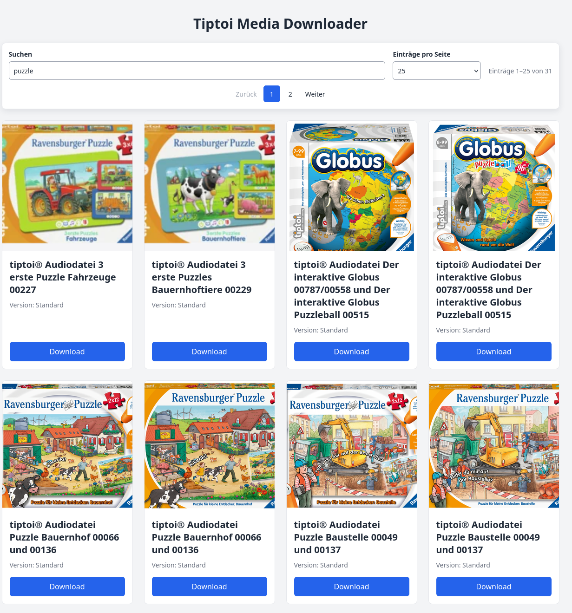

# Tiptoi Audio-Link-Katalog

[English](README.en.md)

Eine private, inoffizielle Weboberfläche zum Durchsuchen öffentlich erreichbarer tiptoi®-Audioeinträge. Der Scraper speichert Titel, Vorschaubild und die URL zur `.gme`-Datei in SQLite. Der Download-Link öffnet anschließend die Datei beim jeweiligen Anbieter.

## Wichtige Hinweise

- Dieses Projekt ist **nicht mit Ravensburger oder tiptoi® verbunden, wird nicht von ihnen unterstützt und ist kein offizielles Produkt**.
- Das Projekt wurde ausschließlich für private, experimentelle Zwecke erstellt. Eine Nutzung oder Weitergabe heruntergeladener Inhalte wird damit nicht erlaubt.
- Nach Kenntnisstand des Projekts bietet Ravensburger derzeit keine offizielle native tiptoi®-Software für Linux an. Diese unabhängige Weboberfläche ist kein offizieller Ersatz dafür.
- Das Projekt wurde vollständig mithilfe von KI erstellt. Code, Dokumentation und Gestaltung wurden KI-generiert; eine vollständige fachliche oder rechtliche Prüfung wird nicht zugesichert.
- Marken, Produktnamen, Bilder und Audiodateien gehören ihren jeweiligen Rechteinhabern. Dieses Projekt enthält und lizenziert diese Inhalte nicht. Prüfe vor Nutzung die geltenden Bedingungen und Rechte. Veröffentliche oder verteile keine Inhalte, zu deren Weitergabe du nicht berechtigt bist.

## Funktionen

- Scrapt Produktnamen, Vorschaubilder und `.gme`-Links von der Ravensburger-Service-Seite.
- Filtert Titel direkt während der Eingabe, auch mit deutschen Umlauten.
- Bietet Seitengrößen von 25, 50, 75, 100 oder allen Einträgen.
- Zeigt eine sticky Such- und Seitennavigation.
- Leitet den Download-Link direkt zur externen `.gme`-Datei weiter. Die Audiodatei wird nicht vom Scraper in SQLite oder im Docker-Volume gespeichert.
- Verwendet SQLite im persistenten Docker-Volume `media_data` und verhindert doppelte Audio-URLs.

## Screenshots

Die folgenden Screenshots verwenden synthetische Beispieldaten und neutrale Platzhaltergrafiken. Sie enthalten keine Ravensburger-Bilder oder Audiodateien.

### Desktop


### Suche



### Mobil


## Start mit Docker Compose

Voraussetzung: Docker Engine und Docker Compose V2.

```sh
docker compose up --build
```

Öffne anschließend <http://localhost:8000>. Compose startet die Weboberfläche und führt den Scraper einmal aus. Die Scraper-Ausgabe lässt sich mit folgendem Befehl verfolgen:

```sh
docker compose logs -f scraper
```

Für einen späteren manuellen Scrape:

```sh
docker compose run --rm scraper
```

Die SQLite-Datei liegt im Container unter `/data/database.db`; das benannte Volume `media_data` bewahrt sie zwischen Container-Neuerstellungen. `docker compose down` entfernt die Container, lässt das Volume aber bestehen. **`docker compose down -v` löscht das Volume und damit die Datenbank.**

## Architektur

- **Web:** FastAPI, Jinja2 und lokale CSS-Dateien.
- **Scraper:** Python-Standardbibliothek (`urllib` und `html.parser`); Chromium ist nicht erforderlich.
- **Datenbank:** SQLite mit eindeutiger Audio-URL.
- **Container:** Multi-Stage-Dockerfile; Quellcode wird ins Image kopiert, Daten liegen separat im Volume.

## Lizenz und Rechte

Für dieses private, vollständig KI-erstellte Projekt wird derzeit **keine Open-Source-Lizenzdatei** mitgeliefert. Ohne Lizenz wird keine ausdrückliche Erlaubnis zur Weiterverwendung des Projektcodes erteilt; die konkrete Rechtslage für KI-generierte Inhalte hängt vom Einzelfall und der Rechtsordnung ab.

Falls der eigene Projektcode später bewusst zur Wiederverwendung freigegeben werden soll, ist MIT eine einfache Option **nur für den Originalcode, an dem eine Lizenz erteilt werden darf**. Eine solche Lizenz würde weder Rechte an Ravensburger/tiptoi® noch an Bildern, Audio-Dateien oder sonstigen Drittinhalten gewähren. Dies ist keine Rechtsberatung.
